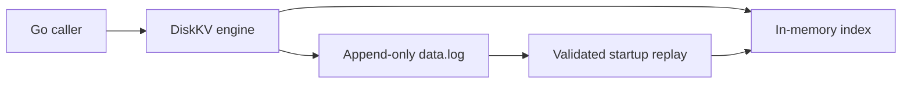

# DiskKV

A persistent key-value storage engine in Go, built around an append-only data log, a rebuildable in-memory index, and explicit failure handling.

DiskKV currently provides an **embedded storage engine**. Each successful mutation is synchronized to the data file before its index entry becomes visible. Startup validates the log rather than silently discarding damaged records.

## Implemented

- Binary keys and values, with `Set`, `Get`, `Delete`, and `Exists`.
- A versioned record format with separate CRC32C checksums for metadata and payload.
- An in-memory key-to-offset index; values remain in the data file.
- Concurrent access through a read/write lock and positional reads.
- Strict recovery, explicit incomplete-tail repair, and a faulted state after storage failures.
- Exclusive advisory locking on Linux and macOS.

Compaction, networking, the CLI, and rate limiting are later milestones. They are not part of the current API.

## Architecture



`Set` encodes one record, appends it, calls `Sync`, and then updates the index while holding the exclusive lock. `Delete` appends a tombstone for an existing key. `Get` holds a read lock while it reads the indexed record with `ReadAt` and verifies its checksum and identity. `Exists` checks index membership without reading or validating the value.

On startup, DiskKV checks the file header and every record, applies replacements and tombstones in order, and rebuilds the index. The log is the source of truth; there is no separate write-ahead log or persisted index.

## Quick start

Requirements: Go 1.25 or later, Linux or macOS, and a local filesystem that supports file and directory synchronization and advisory locking.

```sh
git clone https://github.com/Ahmad-Mosha/kv-store.git
cd kv-store
go test -race ./...
```

Use the engine from a Go program:

```go
package main

import (
    "fmt"
    "log"
    "os"

    diskkv "github.com/Ahmad-Mosha/kv-store"
)

func main() {
    if err := os.MkdirAll("data", 0700); err != nil {
        log.Fatal(err)
    }
    db, err := diskkv.Open("data")
    if err != nil {
        log.Fatal(err)
    }
    defer func() {
        if err := db.Close(); err != nil {
            log.Print(err)
        }
    }()

    if err := db.Set([]byte("city"), []byte("Cairo")); err != nil {
        log.Print(err)
        return
    }
    value, err := db.Get([]byte("city"))
    if err != nil {
        log.Print(err)
        return
    }
    fmt.Println(string(value)) // Cairo
}
```

The data directory must already exist. DiskKV creates `data.log` and a persistent `LOCK` file inside it. Close the database before moving its files; do not delete `LOCK` to bypass a running process.

## API behavior

| Operation | Contract |
|---|---|
| `Open(dir)` | Creates a new log if absent, or validates and recovers the entire existing log. |
| `Set(key, value)` | Appends and synchronizes a replacement value. |
| `Get(key)` | Returns independent value bytes, or `ErrNotFound`. |
| `Delete(key)` | Appends a deletion; a missing key is a successful no-op. |
| `Exists(key)` | Reports current index membership. |
| `Close()` | Waits for active operations, closes the file, and releases the lock. Repeated calls are harmless. |
| `RepairTail(dir)` | Exclusively opens an existing log and explicitly discards a structurally incomplete final record. Returns the number of bytes discarded. |

Keys contain 1–4,096 bytes. Values contain 0–1,048,576 bytes. Both may contain arbitrary binary data. Callers must not modify input slices while an operation uses them. Use `errors.Is` to inspect exported sentinel errors.

## Durability and recovery

Successful mutations complete the append and file `Sync` before returning. Opening a validated database also synchronizes the file and its containing directory. This establishes an explicit ordering contract; persistence still depends on the operating system, filesystem, and device honoring synchronization.

A process crash, an OS crash, and power loss are different failure models. Subprocess termination tests exercise process-crash recovery while the OS remains alive. They do **not** establish power-loss safety. See the [durability contract](docs/durability.md) for the assumptions, uncertain outcomes, and repair policy.

An append, synchronization, read I/O, or detected integrity failure faults the handle. Further valid data operations return `ErrFaulted` until it is closed and reopened. A mutation returning an error may nevertheless appear after recovery if its complete record reached the file; errors do not imply rollback.

`Open` rejects an incomplete record, checksum mismatch, invalid metadata, or unsupported format. It does not rewrite the existing data file. `RepairTail` is an explicit salvage operation, not automatic startup cleanup: a truncated final record can also reflect storage corruption. It refuses bad checksums, invalid lengths, unsupported versions, and incomplete file headers. Back up damaged files before choosing to discard bytes.

## Verification

```sh
test -z "$(gofmt -l .)"
go vet ./...
go build ./...
go test -race -cover ./...
go test -run '^$' -fuzz '^FuzzDecodeRecord$' -fuzztime 10s
```

The test suite exercises serialization, truncation and corruption, reopen behavior, concurrent access, a reference-map workload, process locking, process termination, and injected I/O failures. CI runs formatting, vet, build, and race-enabled tests on Linux and macOS. Passing race tests covers executed code paths; it is not a proof that every possible execution is race-free.

## Limits and next milestones

The current engine uses one data file and synchronizes each mutation separately. Writes and maintenance exclude readers. Recovery scans the entire log, and the index consumes memory proportional to the number and size of live keys. Updates and deletions accumulate obsolete records until compaction is implemented. Locks are advisory: external programs must not modify files behind an open database.

The remaining milestones are:

1. Manual compaction with replacement-stage fault injection, following the [compaction design](docs/compaction-design.md).
2. A bounded TCP protocol and CLI, protected by the existing [Go Rate Limiter](https://github.com/Ahmad-Mosha/rate-limiter) module without duplicating its implementation.
3. Reproducible benchmarks and a final engineering review. Measurements will cover sync overhead, reads/writes, recovery, concurrency, and compaction; no performance results are published yet.

TTL, distributed operation, multi-key transactions, and background compaction are outside the MVP.

The binary layout is documented in the [storage format](docs/storage-format.md).
