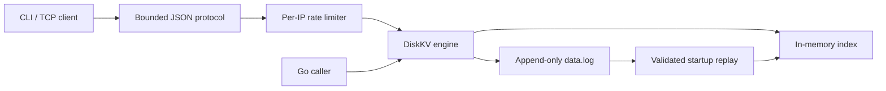

# DiskKV

A persistent key-value storage engine in Go, built around an append-only data log, a rebuildable in-memory index, and explicit failure handling.

DiskKV provides an **embedded storage engine and a bounded TCP server**, with a command-line client and per-IP request limits. Each successful mutation is synchronized to the data file before its index entry becomes visible. Startup validates the log rather than silently discarding damaged records.

## Implemented

- Binary keys and values, with `Set`, `Get`, `Delete`, and `Exists`.
- A versioned record format with separate CRC32C checksums for metadata and payload.
- An in-memory key-to-offset index; values remain in the data file.
- Concurrent access through a read/write lock and positional reads.
- Strict recovery, explicit incomplete-tail repair, and a faulted state after storage failures.
- Exclusive advisory locking on Linux and macOS.
- Manual compaction with synchronized file replacement and replacement-stage fault injection.
- A newline-delimited JSON protocol for binary-safe `SET`, `GET`, `DELETE`, and `EXISTS` commands.
- Connection, frame-size, and network deadline limits, with graceful shutdown of admitted requests.
- Per-IP token buckets from the existing [Go Rate Limiter](https://github.com/Ahmad-Mosha/rate-limiter) module.

## Architecture



`Set` encodes one record, appends it, calls `Sync`, and then updates the index while holding the exclusive lock. `Delete` appends a tombstone for an existing key. `Get` holds a read lock while it reads the indexed record with `ReadAt` and verifies its checksum and identity. `Exists` checks index membership without reading or validating the value.

On startup, DiskKV checks the file header and every record, applies replacements and tombstones in order, and rebuilds the index. The log is the source of truth; there is no separate write-ahead log or persisted index.

`Compact` pauses operations, validates and copies current live records into a sibling temporary file, synchronizes it, renames it over the data file, synchronizes the directory, and publishes the new handle and index. The [compaction protocol](docs/compaction-design.md) defines the behavior of each failure stage.

## Quick start

Requirements: Go 1.25 or later, Linux or macOS, and a local filesystem that supports file and directory synchronization and advisory locking.

```sh
git clone https://github.com/Ahmad-Mosha/kv-store.git
cd kv-store
go test -race ./...
go build -o ./bin/diskkv ./cmd/diskkv
go build -o ./bin/diskkv-cli ./cmd/diskkv-cli
./bin/diskkv -data ./data
```

In another terminal:

```sh
./bin/diskkv-cli set city Cairo
./bin/diskkv-cli get city
./bin/diskkv-cli exists city
./bin/diskkv-cli delete city
```

These commands print `OK`, `Cairo`, `true`, and `OK`. Stop the server with Ctrl-C; reopening the same data directory recovers its log. The server creates the data directory when needed and listens on `127.0.0.1:7379` by default. It provides no authentication or TLS; use it only on a trusted local interface or through a separately secured connection.

Flags precede the CLI command. `-base64` accepts base64-encoded keys and SET values and prints GET results as base64:

```sh
./bin/diskkv-cli -base64 set YmluYXJ5 AP8K
./bin/diskkv-cli -base64 get YmluYXJ5
```

The second command prints `AP8K`. Plain GET output is the stored bytes followed by a newline. Missing keys, rate limits, invalid responses, and network failures return a nonzero exit status. The CLI uses one connection and a five-second total timeout per invocation; it never retries a request automatically. The [protocol reference](docs/protocol.md) defines framing, errors, configuration, and shutdown behavior.

The embedded API remains available independently of the TCP server:

```go
package main

import (
    "fmt"
    "log"
    "os"

    "github.com/Ahmad-Mosha/kv-store/engine"
)

func main() {
    if err := os.MkdirAll("data", 0700); err != nil {
        log.Fatal(err)
    }
    db, err := engine.Open("data")
    if err != nil {
        log.Fatal(err)
    }
    defer func() {
        if err := db.Close(); err != nil {
            log.Print(err)
        }
    }()

    if err := db.Set([]byte("city"), []byte("Cairo")); err != nil {
        log.Print(err)
        return
    }
    if err := db.Compact(); err != nil {
        log.Print(err)
        return
    }
    value, err := db.Get([]byte("city"))
    if err != nil {
        log.Print(err)
        return
    }
    fmt.Println(string(value))
}
```

The data directory must already exist. DiskKV creates `data.log` and a persistent `LOCK` file inside it. `LOCK` records successful initialization as well as coordinating exclusive access. Close the database before copying or moving the directory; preserve `data.log` and `LOCK` together. Do not delete `LOCK` to bypass a running process or a missing-data-file error.

## API behavior

| Operation | Contract |
|---|---|
| `Open(dir)` | Validates and recovers an existing log, or creates one only when initialization evidence and compaction artifacts are absent. |
| `Set(key, value)` | Appends and synchronizes a replacement value. |
| `Get(key)` | Returns independent value bytes, or `ErrNotFound`. |
| `Delete(key)` | Appends a deletion; a missing key is a successful no-op. |
| `Exists(key)` | Reports current index membership. |
| `Compact()` | Replaces the log with validated live records while holding the exclusive lock. |
| `Close()` | Waits for active operations, closes the file, and releases the lock. Repeated calls are harmless. |
| `RepairTail(dir)` | Exclusively opens an existing log and explicitly discards a structurally incomplete final record. Returns the number of bytes discarded. |

Keys contain 1–4,096 bytes. Values contain 0–1,048,576 bytes. Both may contain arbitrary binary data. Callers must not modify input slices while an operation uses them. Use `errors.Is` to inspect exported sentinel errors.

## Durability and recovery

Successful mutations complete the append and file `Sync` before returning. Opening a validated database also synchronizes the file and its containing directory. This establishes an explicit ordering contract; persistence still depends on the operating system, filesystem, and device honoring synchronization.

A process crash, an OS crash, and power loss are different failure models. Subprocess termination tests exercise process-crash recovery while the OS remains alive. They do **not** establish power-loss safety. See the [durability contract](docs/durability.md) for the assumptions, uncertain outcomes, and repair policy.

An append, mutation synchronization, read I/O, or detected integrity failure faults the handle. During compaction, temporary-file failures before rename leave the original database usable; source errors, rename errors, and directory-sync failures after rename fault the handle. Further valid data operations then return `ErrFaulted` until close/reopen. A mutation returning an error may nevertheless appear after recovery if its complete record reached the file; errors do not imply rollback. An error closing the old file after successful compaction reports cleanup failure while the new database remains active.

`Open` rejects an incomplete record, checksum mismatch, invalid metadata, or unsupported format. It does not rewrite the existing data file. `RepairTail` is an explicit salvage operation, not automatic startup cleanup: a truncated final record can also reflect storage corruption. It refuses bad checksums, invalid lengths, unsupported versions, and incomplete file headers. Back up damaged files before choosing to discard bytes.

A missing `data.log` with a nonempty `LOCK` or `.compact-*` artifacts is an error, not an empty database. Existing valid logs with an empty `LOCK` are marked after validation. Leftover compaction files are ignored when the authoritative log exists; startup neither promotes nor removes them.

## Server and rate limiting

The server handles each connection sequentially in one goroutine. Separate clients share the engine's concurrency controls. Defaults are 128 simultaneous connections, a 2 MiB JSON frame limit, a 30-second deadline to read each frame, and a five-second deadline to write each response. A connection beyond capacity closes immediately. Maximum decoded key and value sizes match the embedded API. These limits bound individual connections and frames; they do not impose a total database size or index-memory quota.

The token bucket uses the peer socket's IP address, independent of source port, so opening a new connection does not reset its budget. Defaults allow a burst of 100 requests and refill 50 tokens per second. Complete, well-formed frames consume budget before command validation; denied requests do not reach storage. A `RATE_LIMITED` response includes `retry_after_ms` and leaves the connection usable. A limiter failure rejects the command with `UNAVAILABLE`.

DiskKV imports `github.com/Ahmad-Mosha/rate-limiter/limiter` at the pinned Go pseudo-version `v0.0.0-20260902172527-59b884aab31c`; the algorithm is neither copied nor modified. Both modules require Go 1.25. Configuration validation rejects invalid capacities, nonfinite or nonpositive refill rates, and refill periods above 24 hours before starting resources. The upstream package also includes a Redis implementation, so its Redis client and supporting packages appear in the dependency graph; this server uses the in-memory bucket and requires no Redis service.

Limiter state resets on restart. The upstream implementation periodically removes buckets idle long enough to refill, but has no hard cap on distinct IP entries. Connection limits therefore do not establish a strict bound on limiter memory under sustained IP churn. Clients sharing an IP share a budget. An intervening TCP proxy is the peer unless it preserves source addresses; the protocol accepts no client-supplied identity override.

On shutdown, the server stops accepting connections, closes idle connections, and allows admitted commands and their responses to finish. After the configured deadline, it closes remaining connections and exits with an error. Filesystem I/O cannot be canceled by closing a socket. If drain times out, the command skips a blocking database close and lets process exit release resources. A lost response, write failure, or timeout can leave a mutation's outcome uncertain; reconnect and inspect application state rather than assuming rollback.

## Performance

Local measurements on an Apple M1 Pro, 16 GiB RAM, internal APFS SSD, macOS 26.5.2, and Go 1.26.0. Values below are medians of five runs with a 500 ms benchmark target at `GOMAXPROCS=1`, with warm OS caches.

| Operation | Workload | Median per operation |
|---|---|---:|
| Get | 1 KiB value, 1,024 live keys | 1.184 µs |
| Set | 1 KiB value, append + file `Sync` | 4.310 ms |
| Recovery | Full Open + Close, 1,000 records | 7.601 ms |
| Recovery | Full Open + Close, 10,000 records | 25.676 ms |
| Compaction | 10,000 SETs, 500 DELETEs, 500 live keys | 12.021 ms |

Per-write synchronization dominates small writes on this machine. Additional workers did not improve the measured embedded read workload; the TCP workload benefited from multiple clients. Compaction reduced its fixture's logical log length from 2,980,016 to 148,016 bytes while holding the exclusive lock. These are observations of this environment, not deployment capacity or power-loss guarantees.

The [benchmark report](docs/benchmarks.md) includes sync overhead, concurrency, TCP results, allocation counts, observed ranges, exact fixtures, and all 170 raw samples. Reproduce with:

```sh
go test -p 1 ./engine ./internal/server -run '^$' -bench . -benchmem -benchtime=500ms -count=5 -cpu=1,4
```

## Verification

```sh
test -z "$(gofmt -l .)"
go vet ./...
go build ./...
go test -race -cover ./...
go test ./engine -run '^$' -fuzz '^FuzzDecodeRecord$' -fuzztime 10s
go test ./internal/protocol -run '^$' -fuzz '^FuzzReadFrames$' -fuzztime 10s
```

The test suite exercises serialization, truncation and corruption, reopen behavior, concurrent access, a reference-map workload, process locking, process termination, and injected I/O failures. Compaction tests cover logical-state preservation, replacement-stage failures, cleanup errors, and process termination around replacement. Protocol and networking tests cover framing, malformed and oversized input, request limits, connection lifecycle, deadlines, shutdown, CLI behavior, and restart persistence. CI runs formatting, vet, build, race-enabled tests, and a benchmark smoke run on Linux and macOS. Passing race tests covers executed code paths; it is not a proof that every possible execution is race-free.

## Repository structure

```text
engine/                 Storage engine, codec, recovery, compaction, and colocated tests
internal/protocol/      Bounded JSON framing and request/response validation
internal/server/        TCP lifecycle, dispatch, and rate-limiter integration
cmd/diskkv/             Server executable
cmd/diskkv-cli/         One-shot command-line client
docs/                   Storage format, durability, compaction, and TCP protocol
.github/workflows/      Continuous integration
go.mod                  Go module and dependency versions
```

The public `engine` package owns persistence and concurrency. Internal packages keep transport and request handling separate from storage. Executables compose those packages and own process-level resources. Tests live beside the code they exercise.

## Scope and limitations

The current engine uses one data file and synchronizes each mutation separately. Writes and compaction exclude readers. Recovery scans the entire log, and the index consumes memory proportional to the number and size of live keys. Updates and deletions accumulate obsolete records until manual compaction. Compaction needs extra disk space for the replacement and temporarily retains both indexes in memory. Locks are advisory: external programs must not modify files behind an open database.

TTL, distributed operation, multi-key transactions, and background compaction are outside the MVP.

The binary layout is documented in the [storage format](docs/storage-format.md).
